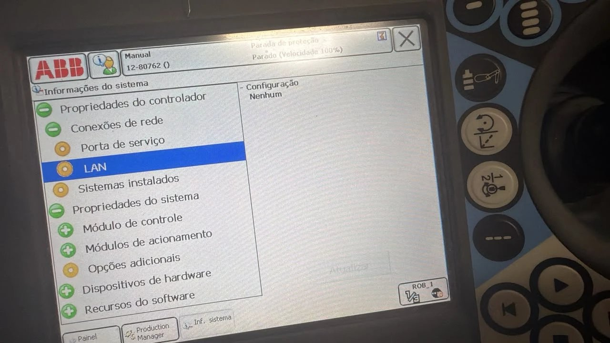
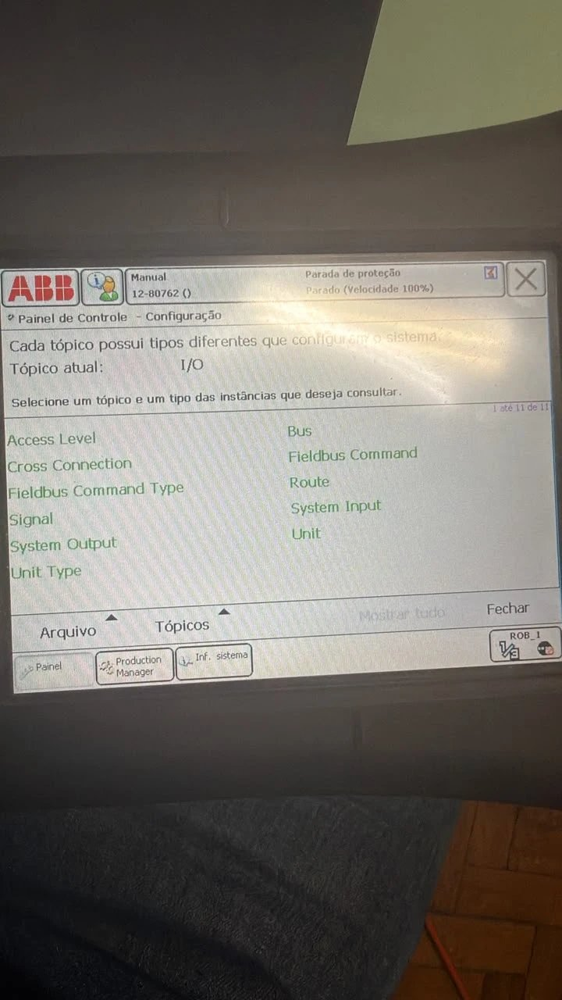
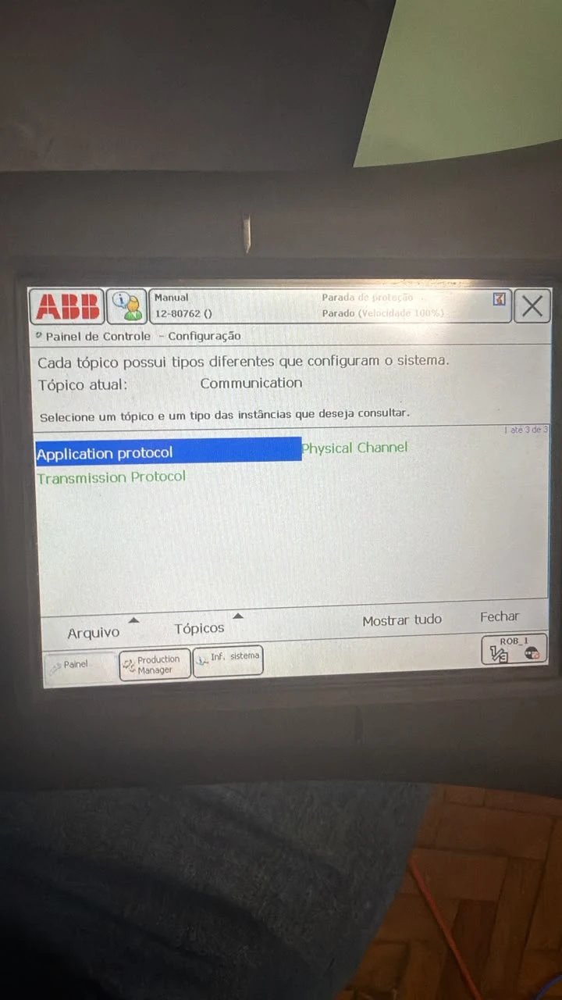
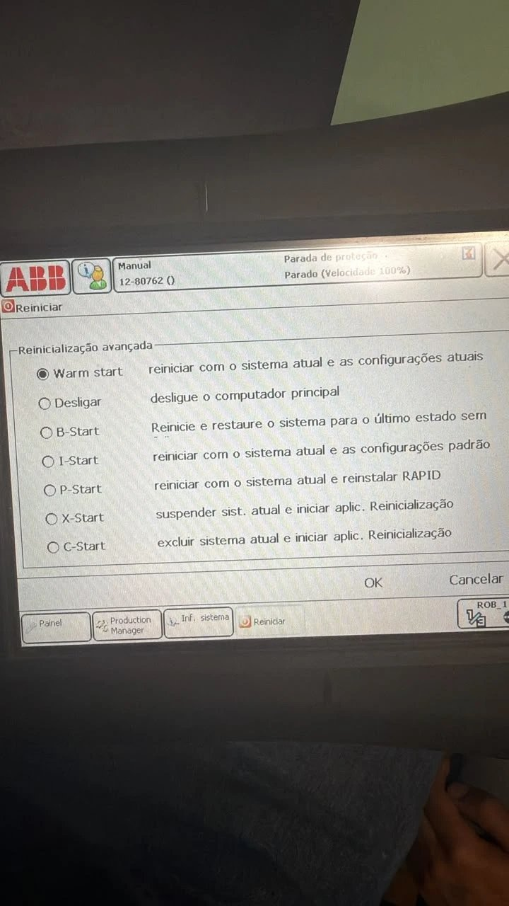
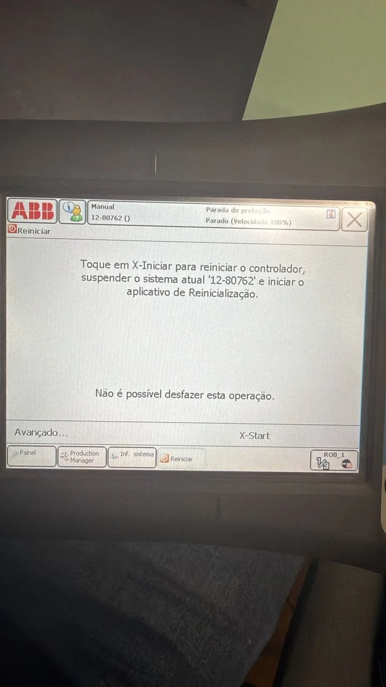
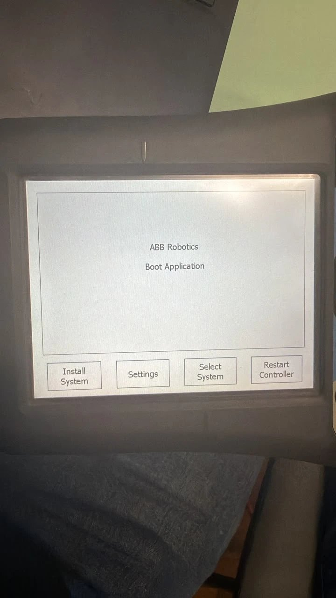
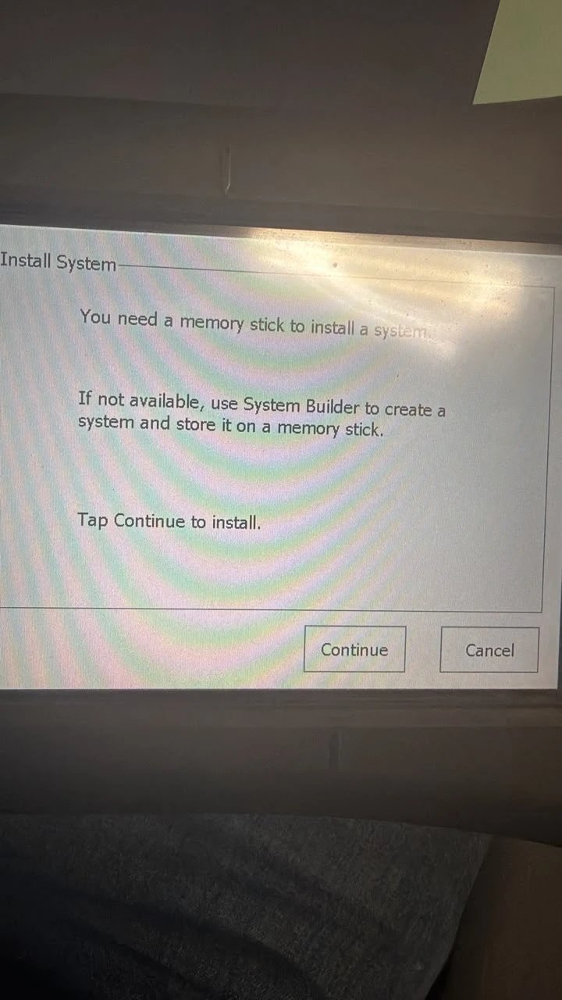
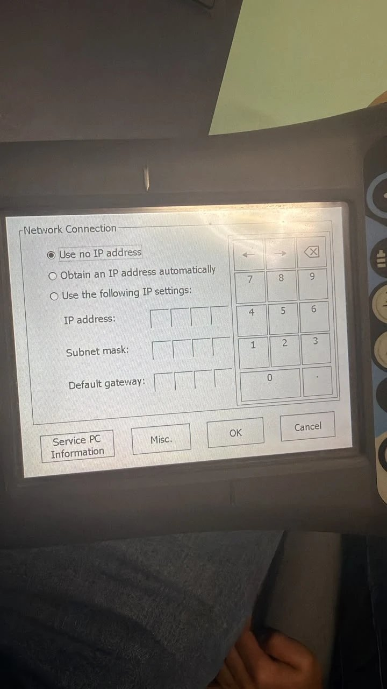

# Passo a passo: controlar três IRB 120 pela rede (painel + Xbox + gêmeo digital)

Este guia leva do zero (robô sem IP na LAN) até controlar os braços pelo painel web, com controle de Xbox,
gravação de sequências e gêmeo digital.

> **Segurança.** O painel **não consegue interromper um movimento em andamento**: o `PyServer.mod` só lê o próximo
> comando depois que o robô termina o atual. A parada de emergência é **sempre o botão físico** do robô /
> FlexPendant. Nos primeiros testes use passo pequeno, velocidade baixa, a mão no botão de emergência e a área
> livre. Teste com **um** robô antes de usar todos juntos.

| Item | Valor usado neste guia |
|---|---|
| Robô 1 (`esq`) | `192.168.0.11` |
| Robô 2 (`dir`) | `192.168.0.12` |
| Robô 3 (`centro`) | `192.168.0.14` |
| PC (Ethernet) | `192.168.0.10`, máscara `255.255.255.0` |
| Porta do servidor RAPID | `1025` |
| Painel web | `http://localhost:8080` |
| Controlador | IRC5, RobotWare 5.14, FlexPendant em português |

---

## Parte 1: Rede

### 1. Cabos
Ligue **a porta LAN do controlador** de cada robô (a do computador principal, não a porta *Service*) e o **cabo do
PC** no mesmo switch.

### 2. IP fixo do PC
Num PowerShell **como administrador** (confira o nome da placa com `Get-NetAdapter`):

```powershell
New-NetIPAddress -InterfaceAlias "Ethernet 2" -IPAddress 192.168.0.10 -PrefixLength 24
```

### 3. Ver como a LAN do robô está hoje
No FlexPendant: **Inf. sistema → Conexões de rede → LAN**.
Se a configuração aparece como **Nenhum**, o robô não tem IP na LAN e precisa de um (passos 4 a 9).


*Conexões de rede → LAN com "Configuração: Nenhum": a porta LAN não tem IP.*

### 4. Atenção: o IP **não** se configura em "Painel de controle → Configuração"
No RobotWare 5.14 o tópico **Communication** só mostra *Application protocol*, *Physical Channel* e
*Transmission Protocol*. Não existe *IP Setting* aí. O IP é definido na **aplicação de boot**.

| Painel de controle → Configuração | Tópico Communication |
|---|---|
|  |  |

### 5. Reiniciar em X-Start (abre a aplicação de boot)
Menu ABB → **Reiniciar** → **Avançado…** e marque **X-Start**.



> **Só X-Start.** Ele *suspende* o sistema atual e abre a aplicação de boot. **Não escolha**
> **C-Start** (apaga o sistema), **I-Start** (configurações padrão), **B-Start** (restaura o último estado) nem
> **P-Start** (reinstala o RAPID).
> Se o robô tiver programas importantes, faça um **backup** antes (menu ABB → *Backup e Restauração*).

A tela seguinte pede confirmação. Toque em **X-Start**. O aviso "não é possível desfazer" vale para o reinício em si
(não dá para cancelar depois do toque): o sistema fica suspenso, **não é apagado**.



### 6. Aplicação de boot → Settings
Na tela **ABB Robotics Boot Application**, toque em **Settings**.



> **Não toque em "Install System".** Ele instala um sistema novo a partir de pen drive.
> Se tocar por engano, aparece a tela abaixo: toque em **Cancel**.
>
> 

### 7. Definir o IP da LAN
Em **Network Connection**, o estado inicial é *Use no IP address*. Marque **Use the following IP settings** e
preencha (use o teclado numérico da tela; `.` fica embaixo à direita):

| Campo | Robô 1 | Robô 2 | Robô 3 |
|---|---|---|
| IP address | `192.168.0.11` | `192.168.0.12` | `192.168.0.14` |
| Subnet mask | `255.255.255.0` | `255.255.255.0` |
| Default gateway | `192.168.0.1` | `192.168.0.1` | `192.168.0.1` |

Toque em **OK**.



### 8. Voltar ao sistema
De volta à tela do boot: **Select System** → escolha o sistema do robô (no robô 1 é `12-80762`; no outro robô o
nome é diferente) → **Restart Controller**. Espere o FlexPendant voltar à tela normal.

### 9. Conferir
- No robô: **Inf. sistema → Conexões de rede → LAN** deve mostrar o IP.
- No PC:

```powershell
ping 192.168.0.11
ping 192.168.0.12
ping 192.168.0.14
```

Repita os passos 3 a 9 em cada um dos outros robôs (`192.168.0.12` e `192.168.0.14`).

---

## Parte 2: Programa RAPID no robô

*(Esta parte não tem fotos; os nomes dos menus podem variar um pouco.)*

### 10. Escolher o arquivo certo para cada robô
No projeto há um `PyServer.mod` pronto por robô, só com o `SERVER_IP` diferente:

| Robô | Arquivo | `SERVER_IP` |
|---|---|---|
| 1 | `rapid\robo_11\PyServer.mod` | `192.168.0.11` |
| 2 | `rapid\robo_12\PyServer.mod` | `192.168.0.12` |
| 3 | `rapid\robo_14\PyServer.mod` | `192.168.0.14` |

Copie para um **pen drive em FAT32** (cada arquivo em uma pasta, para não trocar). O nome do arquivo tem que
continuar `PyServer.mod`.

### 11. Carregar o módulo
No FlexPendant, com o pen drive na **porta USB do FlexPendant**:
1. Menu ABB → **Program Editor** → **Módulos**.
2. Se já existe um `PyServer`, selecione e use **Arquivo → Descartar módulo** (dois módulos com o mesmo nome dão conflito).
3. **Arquivo → Carregar módulo…** → disco USB → o `PyServer.mod` do robô.
4. Abra o módulo e confira a linha `CONST string SERVER_IP := "192.168.0.11";` (`.12` ou `.14` nos outros robôs).

### 12. Rodar o servidor
1. **Rearme a parada de proteção** e ligue os motores.
2. **Debug → PP to Routine → `PyMain`** (a rotina se chama `PyMain`; `PyServer` é o nome do módulo).
3. **Play**. Em modo **Manual**, mantenha o **enable device** (botão de três posições) apertado.
4. O FlexPendant deve mostrar **"PyServer: aguardando cliente na porta 1025"**.

### 13. Testar do PC

```powershell
Test-NetConnection 192.168.0.11 -Port 1025
Test-NetConnection 192.168.0.12 -Port 1025
Test-NetConnection 192.168.0.14 -Port 1025
```

`TcpTestSucceeded : True` nos três = servidores prontos.

---

## Parte 3: Painel

### 14. Subir o painel
No projeto, num terminal (a `.venv` do projeto está quebrada; use o Python do sistema):

```powershell
python painel_robos.py --robot esq=192.168.0.11 --robot dir=192.168.0.12 --robot centro=192.168.0.14
```

Sem argumentos funciona igual (esses são os padrões). O terminal imprime um link com `#token=...`.

### 15. Abrir e conectar
1. Abra o link **no PC onde o controle de Xbox está ligado**, usando `localhost` no lugar do IP
   (ex.: `http://localhost:8080/#token=...`).
2. Clique em **Conectar todos**. Cada cartão passa a mostrar **parado** e a pose/juntas do robô.
3. O gêmeo digital mostra os braços em 3D (arraste para girar, roda para zoom).

### 16. Mover pelo painel
- **Cartesiano** (X, Y, Z) e **juntas** (J1 a J6): escolha o passo e a velocidade (comece com 1 a 5 mm e ~20 mm/s).
- Escolha **qual braço** recebe o comando: `esq`, `dir`, `centro` ou todos.
- **Ir para posição**: digite valores absolutos (pede confirmação).

---

## Parte 4: Controle de Xbox

Clique na página, aperte um botão do controle e clique em **Controle Xbox → Ligar**.

| Controle | Função |
|---|---|
| **LB ou RB** (segurar) | Botão de segurança: sem ele nada se move |
| Analógico esquerdo | J1 (←→) e J2 (↑↓) |
| Analógico direito | J4 (←→) e J3 (↑↓) |
| RT / LT | J5 (+ / −) |
| D-pad ←→ | J6 |
| **Y** | Troca de braço (cada um, depois todos) |
| **A** | Grava o ponto atual na sequência em gravação |
| **B** (com LB/RB apertado) | Volta à posição em que o robô estava ao conectar |
| **X** | Fecha/abre a garra (só indicador, ainda sem comando ao robô) |
| **Back** | Alterna juntas / cartesiano |
| **L3** (segurar) | Movimento lento |

A atribuição de cada eixo é configurável em *Como usar o controle*. O controle só vale com a **aba visível e em
foco**.

**Movimento contínuo (interpolado).** O painel manda a inclinação dos analógicos ~20 vezes por segundo; o servidor
encadeia pequenos passos com **raio de curva** e suaviza a velocidade (rampa de subida), então o robô não "anda e
para". Soltou o LB/RB, ele para no último destino enviado, em menos de meio segundo. No controle a velocidade
máxima é **100 mm/s**, mesmo com o controle deslizante mais alto, e a curva dos analógicos é suave (perto do
centro o movimento é mais fino).

> **Exige a versão atual do `PyServer.mod` no robô** (aceita o raio de curva). Com a versão antiga o painel avisa
> "O programa do robô é a versão antiga" e o jog não funciona: recarregue `rapid\robo_11` / `robo_12` / `robo_14` no robô
> (passos 11 e 12) e rode o `PyMain` de novo. Os movimentos por botão, as posições e as sequências continuam
> funcionando com a versão antiga.

### Gravar e executar sequências
1. Seção **Sequências**: digite um nome e **Iniciar gravação**.
2. Mova o robô e aperte **A** (ou o botão na tela) em cada ponto.
3. **Salvar** (grava em `sequencias.json`).
4. **Executar**: roda os pontos em ordem, com os braços juntos, na velocidade do controle deslizante.
   O primeiro movimento vai **direto** da posição atual ao ponto 1, e o trajeto entre pontos é por juntas
   (não é reta). Só dá para parar **entre** pontos.

---

## Problemas comuns

| Sintoma | Causa provável | O que fazer |
|---|---|---|
| `ping` não responde | Robô desligado, cabo fora do switch, IP não gravado | Confira cabo/luz da porta, o IP em *Conexões de rede → LAN* e refaça os passos 5 a 8 |
| `ping` ok, porta 1025 recusada (`WinError 10061`) | `PyMain` não está rodando, ou `SERVER_IP` errado | Passos 11 e 12; depois de reiniciar o controlador é preciso rodar o `PyMain` de novo |
| Robô não se move | Parada de proteção, motores desligados, modo Manual sem enable device | Rearmar, ligar motores, segurar o enable device |
| `ERR JOINT_LIMIT` / `ERR WORKSPACE` / `ERR UNREACHABLE` | Destino fora dos limites | Escolha um destino dentro da área de trabalho |
| Controle de Xbox "não detectado" | O navegador só expõe o controle após interação | Clique na página e aperte um botão; abra por `localhost` |
| Gêmeo digital com "diferença" alta no TCP | Sentido de alguma junta do modelo difere do robô | Com o robô parado, anote qual junta mexeu e a diferença; só vale com o robô real (no simulador a pose não acompanha as juntas) |
| `.venv` não abre | Foi criada em outro caminho (`F:\Documentos\...`) | Use o Python do sistema; o painel só usa a biblioteca padrão |

## Testar sem robô (simulador)

```powershell
python simulador_robo.py --port 1025 --port 1026 --port 1027
python painel_robos.py --robot esq=127.0.0.1:1025 --robot dir=127.0.0.1:1026 --robot centro=127.0.0.1:1027
```

Os robôs simulados respondem ao mesmo protocolo; nenhum robô real se move.
